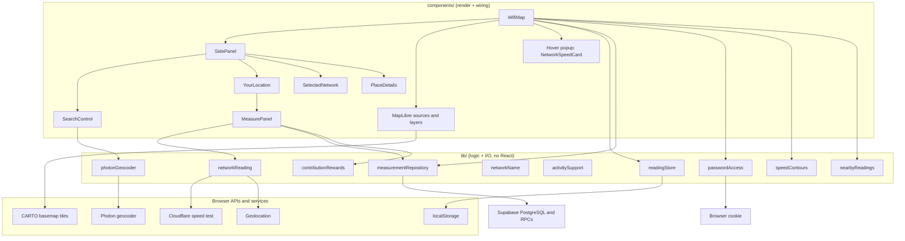
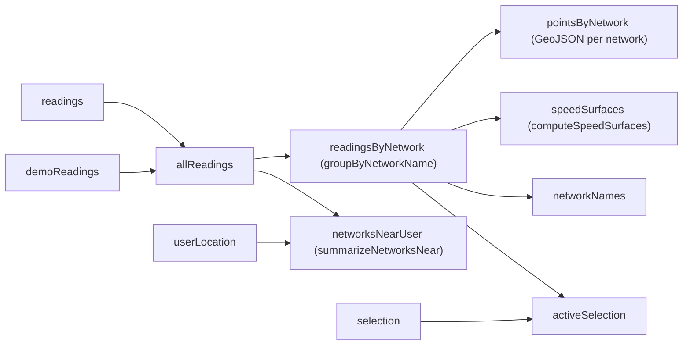

# Architecture

This document explains how Wi-Fi Map is put together: where state lives, how a measurement travels from the button to the map, and how readings become colored speed zones. For setup and the folder map, see the [README](../README.md).

## The big picture

The app is a single page with a local-first persistence layer. Three layers sit on top of each other:

**Why this split.** Components only render and connect things. Anything that computes or talks to the outside world lives in `lib/` as plain TypeScript functions. That keeps the hard parts, like the contour math and name matching, testable without rendering React. It also means changing a library, for example swapping Photon for another geocoder, touches one file.

## State: who owns what

All shared state lives in `WifiMap`, the top-level component. Children receive data as props and report events back through callbacks (`onReading`, `onResult`, `onClear`). This is React's "lifting state up" pattern. There is no global store, because the app has a single page and one owner is enough.

| State | Type | Purpose |
| --- | --- | --- |
| `readings` | `NetworkReading[]` | Your real measurements. Loaded locally, merged with Supabase history, and saved to `localStorage`. |
| `demoReadings` | `NetworkReading[] \| null` | Fake readings for development. Kept separate so they are never saved. |
| `selection` | `PanelSelection` | What the side panel shows: `yourLocation`, a clicked `network`, or a searched `place`. |
| `userLocation` | `UserLocation` | `locating`, `found` (with coordinates), or `unavailable` (with a message). |
| `hoverInfo` | `ReadingDot \| null` | The dot under the mouse, for the popup. |
| `contributionProgress` | `ContributionProgress` | Local Signal balance and contribution streak used for rewards and password actions. |
| `unlockedDemoNetworks` | `string[]` | Dev-only password unlocks, persisted in a 30-day browser cookie. |

`selection` and `userLocation` are **discriminated unions**: each variant has a `kind` or `status` tag and carries only the fields that make sense for it. TypeScript then won't let you read `coordinates` while the status is `locating`. Separate booleans like `isLocating` and `hasError` could contradict each other; a union can't.

Two components keep local state because nothing else needs it:

- `MeasurePanel` tracks its own measurement progress (`idle`, `measuring`, `done`, or `error`) and the text in the name box.
- `SidePanel` tracks whether it's open.

### Derived data

Everything else is computed from that state during render, mostly inside `useMemo` so it only recomputes when its inputs change:

Nothing derived is copied into `useState`. Mirroring derived data into state is a common React bug, because the copy can fall out of sync with its source. The `useMemo` matters for performance: `computeSpeedSurfaces` is the most expensive computation in the app. Without memoization it would rerun on every mouse move, since moving the mouse updates `hoverInfo`.

## Flow of a measurement

1. The user types a name in `MeasurePanel`. As they type, `networkName.ts` cleans it: Unicode normalization, collapsed whitespace, invisible characters removed, curly quotes made straight. It then checks the result against known names, so `cafenet` snaps to the existing spelling `CafeNet`.
2. **Measure** calls `takeNetworkReading(name)` in `lib/networkReading.ts`. That function:
   - asks the browser for a high-accuracy GPS fix, then
   - runs a trimmed Cloudflare speed test of at most about 30 s: latency, then download and upload ramping up to 25 MB and 10 MB.

   The two run one after the other, so a denied location permission doesn't leave a speed test downloading in the background.
3. The resulting `NetworkReading` goes to `WifiMap` through `onReading`. `WifiMap` assigns a UUID and collection timestamp, appends it to `readings`, and treats its coordinates as your latest location.
4. The `persistReadings` effect writes `readings` to `localStorage`.
5. A separate synchronization effect upserts pending readings through `measurementRepository`. The UUID makes retries idempotent; failures remain local and are retried after the browser reports that it is online.
6. The derived data recomputes, and the map redraws the dot and the zones.

Password sharing is a separate opt-in path:

1. `MeasurePanel` checks whether a password exists for the resolved network name and the current
   coordinates through the `network_password_exists` Supabase RPC.
2. If no password exists, the user spends Signal points to reveal the password input.
3. After the measurement, `WifiMap` stores the reading locally and calls `add_network_password`
   with the password. Supabase stores only a bcrypt hash at the coordinate rounded to four decimal
   places; the password is never returned by an RPC.
4. A successful new password earns the additional password-contribution reward. A duplicate or
   failed password submission does not earn that bonus, but the measurement reward still applies.

The dev branch also supplies seeded demo passwords. Those are not sent to Supabase: selecting a
demo network can spend Signal points to reveal its local fixture password, and the unlock name is
stored in a browser cookie for 30 days.

On startup, local readings render immediately. `measurementRepository.listMeasurements()` then loads
historical Supabase readings and merges them by UUID. Missing Supabase configuration is reported in
the side panel and does not prevent local use. Demo readings remain a separate state value and are
never uploaded.

`readingStore.loadReadings()` checks every stored entry on load and drops any that are malformed. It also reapplies the name-cleaning rules, so data saved by older versions of the app still loads.

## Rendering the map

`WifiMap` uses `react-map-gl`, a React wrapper around MapLibre. MapLibre draws the map with WebGL. It doesn't render React elements; it renders **sources** (GeoJSON data) through **layers** (style rules).

- **Speed zones**: one source (`speed-contours`) with a fill layer and an outline layer. Its data is either the combined surface or, when a network is focused, that network's own surface.
- **Reading dots**: one clustered source **per network**. MapLibre's clustering merges every point in a source. With a single shared source, a fast and a slow network in the same cafe would merge into one misleading average. Clusters carry running totals (`clusterProperties`), and the paint expression divides them to color each cluster by its average speed.
- **Popup and side panel**: these are ordinary React elements positioned over the map.

MapLibre paint and layout options must be plain JavaScript objects, so they can't live in CSS. They live in `WifiMap.styles.ts` instead.

## How speed zones are computed (`lib/speedContours.ts`)

The colored zones come from scattered readings in four steps:

1. **Interpolate onto a grid.** `@turf/interpolate` builds a grid of points over the readings. Each grid point gets a speed estimated by **inverse-distance weighting (IDW)**: a weighted average of all readings, where closer readings count more. The weight falls off as 1 / distance³ rather than the usual 1 / distance², so a slow pocket isn't washed out by fast readings a few hundred meters away. The grid is capped at about 5,000 points, and cells grow when readings are spread over a large area.
2. **Draw bands.** `@turf/isobands` traces polygons between speed thresholds (0, 10, 25, 50, and 100 Mbps), much like contour lines on a topographic map. The grid's outermost ring is forced below every threshold. Without that, isobands can't close a band that runs off the grid's edge, and that band would disappear.
3. **Clip to coverage.** IDW will happily guess a speed for places miles from any reading. The bands are therefore cut down to the area within 150 m of an actual reading.
4. **Never interpolate across networks.** Speeds on one network say nothing about another, so every network gets its own surface. For the combined view, the map is split into regions covered by exactly the same set of networks, and each region shows the average of those networks' surfaces. Where one network's coverage ends inside another's, the result is a clean color edge rather than invented rings.

This is the most computationally expensive code in the app: roughly grid points × readings for each network, plus polygon clipping. Large numbers of readings would be the first scaling problem.

## Ratings (`lib/activitySupport.ts`)

Each activity (streaming, gaming, calls, browsing, downloads) has a "works" threshold and a "great" threshold per metric. These are taken from Netflix, the FCC, Zoom, and Xbox guidance, as cited in the file. Each metric is scored so that "works" sits at the middle of the bar and "great" fills it. The activity's final score is its **weakest** metric: a call with fast download but slow upload still freezes for everyone else. Metrics that weren't measured are left out instead of being counted as zero.

## Styling

- Each component's CSS sits in its folder (`MeasurePanel/MeasurePanel.css`), imported by that component. Class names are prefixed with the component name (`measure-panel-error`) to avoid collisions, since all CSS is global once bundled.
- `styles/variables.css` defines shared colors and font sizes as CSS custom properties (`var(--color-text-muted)`). `styles/global.css` imports it and is loaded once from `main.tsx`.
- The speed colors appear twice: as CSS variables, and as literals in `WifiMap.styles.ts`, because MapLibre can't read CSS variables. Keep the two copies in sync.
- Conditional styles use modifier classes or `data-*` attributes. For example, `SidePanel` uses `data-open` and the CSS selects `[data-open='false']`.

## External services and privacy

- **Cloudflare speed test**: downloads and uploads test payloads from `speed.cloudflare.com`. Result logging is turned off (`logAimApiUrl: null`).
- **Photon** (Komoot's public server): receives search queries, and your coordinates for reverse lookups (place names under "Your location" and "Selected network").
- **CARTO**: serves basemap tiles, so it learns roughly which area you're viewing.
- When Supabase is configured, readings are synchronized to the public measurement tables; the
browser retains the local copy for offline use. Password values never leave the browser in
readable form: only their bcrypt hashes are stored by the password RPC. Clearing site data removes
local readings, contribution progress, and demo unlocks, but does not remove remote measurements or
password hashes.

Photon search results are escaped before the geocoder dropdown inserts them as HTML (`EscapingGeocoder` in `SearchControl.tsx`). OpenStreetMap place names are user-edited, so they are untrusted input.

## Build and runtime notes

- **Vite** serves source files as native ES modules in development and bundles them with Rolldown for production. `tsc -b` type-checks only and emits nothing (`noEmit`); Vite does the actual compilation.
- `vite.config.ts` pre-bundles `maplibre-gl` and `react-map-gl/maplibre` together, so they share one MapLibre instance. `WifiMap.tsx` also calls `setWorkerUrl` explicitly. MapLibre otherwise looks for its web worker next to its own module, and after Vite's pre-bundling that file doesn't exist.
- `import.meta.env.DEV` hides the demo-data toggle in production builds.

## Testing and debugging

There is no automated test suite yet. The best first candidates are the pure functions in `lib/`, which need no DOM or React: `networkName.ts`, `activitySupport.ts`, `nearbyReadings.ts`, and `readingStore.toNetworkReading`. Adding [Vitest](https://vitest.dev) would fit, since it reuses the Vite config.

Debugging tips:

- **Stored data**: in DevTools, open Application → Local Storage → `wifi-map:readings`. Malformed entries are skipped on load, so you can edit this safely.
- **Map layers**: run `mapRef.current?.getMap().getStyle().layers` from a breakpoint inside `WifiMap`.
- **Contour problems**: turn on demo data. It's seeded, so the layout is the same every time, and it deliberately includes two networks that overlap.
